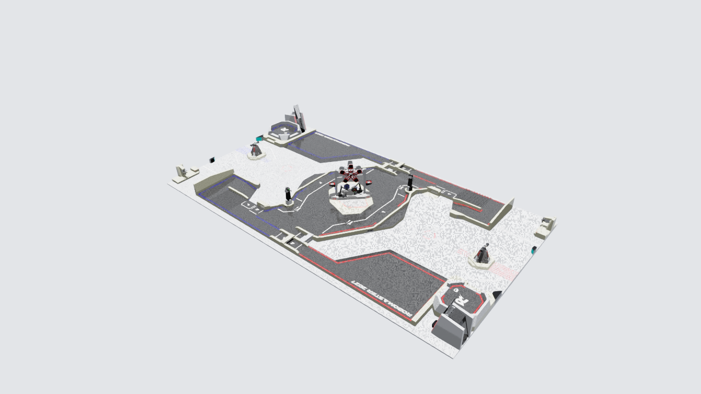

# RMUC2027 场地 3D 模型（机甲大师 2027 赛季）

RoboMaster（机甲大师）2027 赛季高校赛比赛场地的三维模型：官方 STEP 源文件 + 转换好的 Isaac Sim USD 静态资产，基于官方 2026-10-15 发布的 V1.0.0 规则与场地 CAD，资产冻结于 2026-10-16。



## 下载

模型二进制文件较大（合计约 1.4 GiB），放在 [Releases](../../releases) 里，不进 Git 仓库：

| 文件 | 字节数 | 说明 |
|---|---:|---|
| `RMUC2027_V1.0.0.stp` | 653443279 | 官方场地 CAD 源文件（未修改） |
| `field.usda` | 725807678 | Isaac Sim 静态场地，ASCII 版 |
| `field.usdc` | 103504789 | 同上，二进制打包版（日常加载用） |
| `field_meshes.npz` | 47205291 | CAD 装配三角化的中间网格数据 |
| `rmuc2027_rule_manual_v1.0.0_20261015.pdf` | 22455861 | 官方规则手册 V1.0.0 |
| `rmu2027_robot_specification_v1.0.0_20261015.pdf` | 18240763 | 官方机器人规格 V1.0.0 |
| `SHA256SUMS.txt` | 小 | 以上全部文件的 SHA-256 校验值 |

校验方法：把文件下载到同一目录后执行

```bash
sha256sum -c SHA256SUMS.txt
```

## 仓库里有什么（Git 部分）

- `manifest.json`：全部 644 个分件的名称、颜色、三角数与装配变换结果，含单位与坐标约定。
- `field.summary.json`：USD 导出摘要（含各源文件 SHA-256 与根节点信息）。
- `field_culled.usda`：只保留场内主体的轻量 ASCII 版（约 44 KB，供快速查看/遮挡测试）。
- `base_targets.json`、`rules_profile.json`：已核对的规则条目与明确未知项（目标位姿尚未接入）。
- `conversion-requirements.txt`：重建转换环境所用的依赖版本清单。
- `preview/`：场地在 Isaac Sim 中的实际加载截图与 CAD 俯视图。

## 技术参数

- 644 个分件、6055886 个三角面；米制、Z 轴向上；保留 CAD 原始装配位置（原点即 CAD 原点）。
- USD 根节点 `/RMUC2027`；碰撞为静态三角网格（保留凹面与洞口，未做全图凸包）。
- 世界包围盒：min (-13.9999886, -6.3772221, -1.9413437) m；max (14.0000029, 9.6259089, 1.8573394) m。地面 Z 为负是 CAD 原点约定，不代表穿地。
- 官方 STP 的 MD5：`3d3d6a411f44e9a4983794261b3f0bf7`。
- 用法：在 Isaac Sim / Isaac Lab 中直接加载 `field.usdc`（推荐）或 `field.usda`。注意 MuJoCo 普通 mesh 碰撞使用凸包，不能把本资产直接当单个凸碰撞体使用。
- 官方 CAD 不含完整外围围挡。规则矩形按官方 28×15 m 推导为 x∈[-14, 14]、y∈[-5.8756566, 9.1243434]，绝对坐标待现场/细图复核。

## 验证情况（2026-10-16）

- 完整 CAD 已在 6 GB 显存本机的 Isaac Sim 中实际加载并出图（CPU 物理 + 官方 performance 渲染预设）；GPU 物理 + balanced 渲染首次测试显存不足，未作为本机默认。
- 两处真实落球均与斜面产生接触力且未穿地；前向 64×36 深度图有效像素覆盖正常。
- 现有四旋翼本体以经典闭环在场地内悬停 3 秒：最大位置误差 4.9 mm、末速 0.00055 m/s、无接触，整机八角包络 2401 次检查均在界内。
- 这是静态场地资产：前哨站旋转、基地装甲开合、有效攻击判定与 RL 课程均不在本仓库。

## 来源与许可

- 官方规则资料中心：<https://bbs.robomaster.com/wiki/20204847/1969149>
- 官方 2027 场地 CAD 公告：<https://bbs.robomaster.com/article/1970956>
- 官方公告标注 **CC BY-NC-SA 4.0**（署名、非商业、相同方式共享）；详见 [LICENSE](LICENSE)。图纸与规则或现场有差异时，以官方规则和现场为准。
- USD/NPZ 等转换产物由 [robot_lab](https://github.com/keilking66/robot_lab) 项目生成；源 CAD 未做任何修改。
